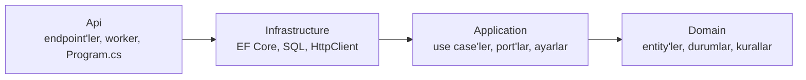
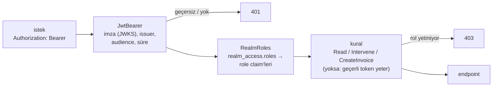
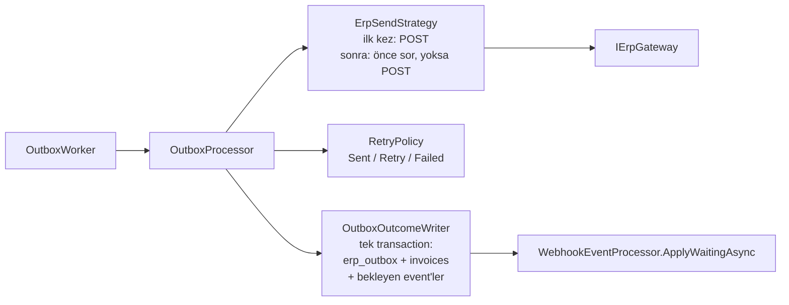
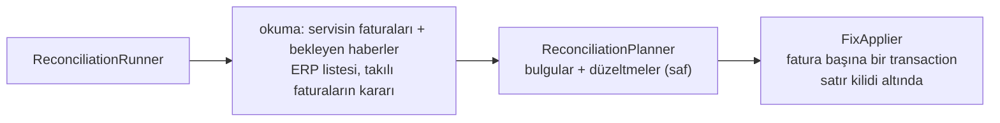
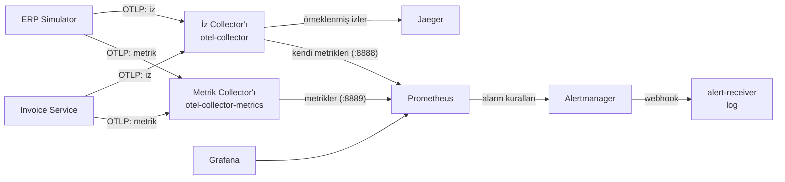

# Mimari

İki uygulama da (Invoice Service ve ERP Simulator) aynı katmanlı yapıdadır: her biri dört projeye bölünmüştür ve
projeler arasındaki referanslar tek yönlüdür. Üçüncü uygulama olan operasyon ekranı (`operations-ui`) tarayıcıda çalışan
küçük bir React uygulamasıdır; katmanlara bölünmemiştir ve yalnızca Invoice Service'in HTTP API'sini kullanır
(bkz. [Operasyon Ekranı](#operasyon-ekranı)). İzleme için Prometheus, Alertmanager, Grafana ve tek dosyalık bir alarm alıcısı
(`alert-receiver`) vardır (bkz. [İzleme](#i̇zleme)). Token'ları Keycloak verir; Invoice Service onları kendisi doğrular
(bkz. [Kimlik doğrulama](#kimlik-doğrulama-invoice-service)).

## Katmanlar ve bağımlılık kuralı



| Katman | Ne içerir | Neye bağımlı olabilir |
|---|---|---|
| **Domain** | Entity'ler (`Invoice`, `ErpOutboxEntry`, `ErpWebhookEvent`; simülatörde `ErpInvoice`, `WebhookDelivery`), durum sabitleri, saf kurallar (`InvoiceTransitions`) | Hiçbir şeye (paket referansı yok) |
| **Application** | Use case'ler (bir işin adımlarını yöneten sınıflar), port'lar (dış dünyaya açılan arayüzler), ayarlar ve doğrulayıcıları, saf politikalar (`RetryPolicy`, `BehaviorSelector`, `WebhookPlanner`) | Domain; `Microsoft.Extensions.*` soyutlamaları (Options, Logging, DI) |
| **Infrastructure** | Port'ların gerçek uygulamaları: `DbContext`, migration'lar, SQL içeren store'lar, ERP'ye / Fatura Servisi'ne giden HTTP istemcileri | Application (ve dolaylı olarak Domain); EF Core, Npgsql |
| **Api** | HTTP endpoint'leri (isteği use case'e verir, sonucu HTTP cevabına çevirir), arka plan worker'ları, `Program.cs`, `appsettings*.json` | Hepsi |

Kural: içteki katman dıştakini bilmez. Örneğin `OutboxProcessor` (Application) PostgreSQL'i ya da `HttpClient`'ı
bilmez; yalnızca `IOutboxStore` ve `IErpGateway` port'larını bilir. Bu yüzden birim testlerde bu port'lar
bellek içi sahteleriyle değiştirilebilir (bkz. [Testler](#testler)).

## Invoice Service

```
invoice-service/
  src/
    InvoiceService.Domain/
      Invoices/        Invoice, InvoiceStatus, InvoiceNumber, InvoiceTransitions, ErpCheckResult, InvoiceFollowUp
      Operators/       OperatorAction, OperatorActionType, OperatorActionResult, OperatorIdentity (ad ve sub)
      Outbox/          ErpOutboxEntry, OutboxStatus
      Webhooks/        ErpWebhookEvent, WebhookEventType, WebhookEventStatus, IgnoreReason
      Reconciliation/  ReconciliationRun, ReconciliationFinding, ReconciliationStatus, FindingType, FindingAction
    InvoiceService.Application/
      Abstractions/    IErpGateway, IInvoiceStore, IOutboxStore, IWebhookEventStore, IReconciliationStore, IReconciliationLock,
                       IOperatorActionStore, IInvoiceFollowUpStore, IUnitOfWork, IDatabaseFailureClassifier
      Invoices/        CreateInvoiceHandler, ResendInvoiceHandler, ResendInvoicesHandler, InvoiceFollowUpHandler, InvoiceQueries,
                       InvoiceReadModels, CreateInvoiceRequest
      Outbox/          OutboxProcessor, ClaimedEntry, ErpSendStrategy, OutboxOutcomeWriter, RetryPolicy, OutboxOptions
      Metrics/         InvoiceMetrics, SendAttemptResult, WebhookResult, DatabaseMetrics, DatabaseMetricsReader, MetricsOptions
      Tracing/         InvoiceTracing (ActivitySource, saklanan traceparent'la span açma)
      Webhooks/        WebhookEventProcessor, InvoiceEventApplier, ErpWebhookRequest, WebhookSignature, WebhookOptions
      Reconciliation/  ReconciliationService, ReconciliationRunner, ReconciliationPlanner, ReconciliationPlan, FixApplier,
                       ReconciliationQueries, ReconciliationOptions
      DependencyInjection.cs
    InvoiceService.Infrastructure/
      Persistence/     InvoiceDbContext, Migrations/, InvoiceStore, OutboxStore, WebhookEventStore, UnitOfWork,
                       ReconciliationStore, OperatorActionStore, InvoiceFollowUpStore, AdvisoryReconciliationLock,
                       PostgresFailureClassifier
      Erp/             ErpClient (IErpGateway), ErpOptions
      DependencyInjection.cs
    InvoiceService.Api/
      Auth/            AuthExtensions (JWT doğrulaması ve rol kuralları), KeycloakSettings, RealmRoles (realm_access →
                       role claim'leri), Roles ve Policies (rol ve kural adları)
      Invoices/        InvoiceEndpoints, InvoiceResponse, InvoiceReadResponses, BulkResendResponses
      Webhooks/        WebhookEndpoints, WebhookRequestReader
      Reconciliation/  ReconciliationEndpoints, ReconciliationResponses
      Operators/       OperatorName (müdahaleyi yapanın adı ve sub'ı token'dan)
      Workers/         OutboxWorker, ReconciliationWorker, DatabaseMetricsWorker
      Paging.cs        sayfalı listelerin page / pageSize doğrulaması
      Startup/         LoggingExtensions (TraceIdConsoleFormatter), OpenApiExtensions, DatabaseMigrator, SettingsLogger,
                       CorsExtensions, BackgroundQuerySampler
      Program.cs
  tests/
    InvoiceService.Domain.Tests / .Application.Tests / .Infrastructure.Tests / .Api.Tests / .IntegrationTests
```

### Port'lar

| Port | Ne için | Uygulaması |
|---|---|---|
| `IErpGateway` | ERP'ye faturayı gönder (`SendAsync`), faturayı ve kararını sor (`FindAsync`), aralıktaki kayıtları listele (`ListAsync`) | `ErpClient` |
| `IInvoiceStore` | `invoices` tablosu: numara üret, fatura + outbox kaydını birlikte yaz, oku, sayfalı liste ve arama, durum başına sayı ve takılı sayısı, koşullu güncelle, satır kilidi | `InvoiceStore` |
| `IOutboxStore` | `erp_outbox`: `FOR UPDATE SKIP LOCKED` ile kayıt al, claim hâlâ bizde mi, sonucu claim'e göre yaz, sıfırla, faturanın kaydını oku | `OutboxStore` |
| `IWebhookEventStore` | `erp_webhook_events`: bir kez sakla (`ON CONFLICT`), oku, faturanın haberlerini listele, bekleyenleri kilitle, `SET LOCAL` süre limitleri | `WebhookEventStore` |
| `IUnitOfWork` | Transaction sınırı: aynı DI scope'undaki store'lar aynı transaction'a katılır | `UnitOfWork` |
| `IReconciliationStore` | `reconciliation_runs` / `reconciliation_findings`; mutabakatın okuduğu fatura ve haber listeleri; bir faturanın bulguları; ERP'ye sorulan faturalara cevabın yazılması; son tamamlanan çalışmanın zamanı (metrik için) | `ReconciliationStore` |
| `IOperatorActionStore` | `operator_actions`: müdahaleyi açık transaction'da hemen yaz, bir faturanın müdahalelerini oku | `OperatorActionStore` |
| `IInvoiceFollowUpStore` | `invoice_follow_ups`: açık takibi bul, geçmişi oku, yaz, kapat; bir sayfanın açık takiplerini tek sorguda oku | `InvoiceFollowUpStore` |
| `IReconciliationLock` | Aynı anda tek mutabakat: bırakılana kadar tutulan kilit; başkasındaysa `null` | `AdvisoryReconciliationLock` |
| `IDatabaseFailureClassifier` | Veritabanı hatası `lock_timeout` / `statement_timeout` mu (webhook'ta 503 için) | `PostgresFailureClassifier` |

### Akışlar

**İsteğin kimliği** — webhook ve `/health` dışındaki her istek endpoint'e varmadan iki kontrolden geçer:



Anahtarlar ilk istekte `Keycloak:BaseUrl`'deki realm'in discovery belgesinden ve JWKS'inden alınır ve bellekte tutulur. Webhook
(isteği kendi HMAC kontrolü doğrular) ve `/health` `AllowAnonymous`'tur.

**Fatura oluşturma** — `POST /api/v1/invoices` → `CreateInvoiceHandler`: doğrula, numara al, faturayı ve outbox
kaydını tek kayıtta yaz (`IInvoiceStore.QueueAsync`) → `202`. ERP bu istekte çağrılmaz. İstek kendi trace'idir; faturanın
trace'i worker kaydı kuyruktan ilk aldığında başlar ve `trace_parent`'a yazılır ([İzleme](#i̇zleme)).

**Gönderim** — `OutboxWorker` (Api) boş slot kadar kaydı `OutboxProcessor.ClaimAsync` ile alır ve her biri için
yeni bir DI scope'unda `OutboxProcessor.SendAsync` çağırır:



**ERP webhook'u** — `POST /api/v1/erp-webhooks` → `WebhookEndpoints` gövdeyi okur, imzayı ve gövdeyi doğrular,
işi kendi scope'unda `WebhookEventProcessor.ReceiveAsync`'e verir ve en fazla `ResponseBudgetMilliseconds` bekler
(yoksa `503`). `WebhookEventProcessor` event'i bir kez saklar, faturayı kilitler ve `InvoiceEventApplier` ile uygular
(geçiş kuralları `InvoiceTransitions`'ta).

**Mutabakat** — `ReconciliationWorker` ayardaki aralıkta, `POST /api/v1/reconciliation-runs` ise istendiğinde
`ReconciliationService.TryStartAsync`'i çağırır: kilit alınırsa çalışma `Çalışıyor` olarak kaydedilir (alınamazsa
`null`; endpoint `409`, worker o turu atlar). `ReconciliationRunner` önce her şeyi okur, sonra yazar:



ERP'ye ulaşılamazsa çalışma Başarısız olur ve hiçbir fatura değişmemiştir (yazma henüz başlamamıştır).

**Yeniden gönderme** — `POST /api/v1/invoices/{n}/resend` → endpoint operatörün adını ve sub'ını token'dan okur (`OperatorName`,
`preferred_username` ve `sub`; kullanılabilir ad yoksa `403`) → `ResendInvoiceHandler`: yalnızca Başarısız fatura Bekliyor'a döner ve outbox kaydı sıfırlanır; `operator_actions`
kaydı aynı transaction'da yazılır (reddedilen istekte yalnızca kayıt); sonuç `Queued` / `NotFound` / `NotFailed` → `202` /
`404` / `409`.

**Toplu yeniden gönderme** — `POST /api/v1/invoices/resend` → `ResendInvoicesHandler`: 1–100 numara; tekrarlanan numara
bir kez işlenir; her numara sırayla `ResendInvoiceHandler`'dan (kendi transaction'ıyla) geçer, böylece tekli resend'in
kuralları ve aynı anda iki resend'e karşı koşullu UPDATE aynen geçerlidir. Bir faturanın hatası diğerlerini durdurmaz;
cevap her fatura için ayrı sonuçtur (`queued`, `not_found`, `not_failed` + şu anki durum, `error`). Her fatura kendi
`operator_actions` satırını alır; hata veren faturanın transaction'ı geri alındığı için hatası ayrıca yazılır.

**Elle takip** — `POST /api/v1/invoices/{n}/follow-up` (ve `/close`) → `InvoiceFollowUpHandler`: faturanın satır kilidi alınır, fatura
takılı değilse ya da açık takibi varsa reddedilir; takip ve `operator_actions` kaydı aynı transaction'dadır. Fatura değişmez.

**Ekranın okumaları** — `InvoiceQueries`: sayfalı liste, arama ve takılı süzgeci (`ListPageAsync`), özet (`CountByStatusAsync`,
`CountStuckAsync`, `QueueStatsAsync`; hepsi tek `REPEATABLE READ` anlık görüntüsünde), detay (fatura, outbox kaydı, haberler, bulgular ve müdahaleler; ayrı okumalar, tek anlık görüntü değil).
`ReconciliationQueries`: sayfalı çalışma listesi ve bir çalışmanın bulguları.

## ERP Simulator

```
erp-simulator/
  src/
    ErpSimulator.Domain/
      Invoices/        ErpInvoice
      Webhooks/        WebhookDelivery, DeliveryStatus, DeliveryKind, ErpEventType
    ErpSimulator.Application/
      Abstractions/    IErpInvoiceStore, IWebhookDeliveryStore, IWebhookTransport, IUnitOfWork
      Invoices/        SubmitInvoiceHandler, InvoiceLookup, InvoiceListing, InvoiceDecisions, CreateInvoiceRequest
      Simulation/      BehaviorSelector, SimulatorOptions, SimulatorMetrics
      Webhooks/        WebhookSender, WebhookPlanner, WebhookSignature, WebhookOptions, SimulatorTracing
      DependencyInjection.cs
    ErpSimulator.Infrastructure/
      Persistence/     ErpDbContext, Migrations/, ErpInvoiceStore, WebhookDeliveryStore, UnitOfWork
      Webhooks/        HttpWebhookTransport (IWebhookTransport)
      DependencyInjection.cs
    ErpSimulator.Api/
      Invoices/        InvoiceEndpoints, InvoiceResponses
      Workers/         WebhookDispatcher
      Startup/         LoggingExtensions (TraceIdConsoleFormatter), OpenApiExtensions, DatabaseMigrator, SettingsLogger,
                       BackgroundQuerySampler
      Program.cs
  tests/
    ErpSimulator.Application.Tests / .Infrastructure.Tests
```

**Fatura POST'u** — `InvoiceEndpoints` → `SubmitInvoiceHandler`: doğrula, (idempotent modda) fatura numarasını
kilitle ve var olan kaydı ara, davranışı seç (`BehaviorSelector`), davranışa göre kaydet (`IErpInvoiceStore.SaveAsync`
kaydı ve `WebhookPlanner`'ın planladığı event'leri tek transaction'da yazar), geç cevapta bekle. Sonucu
(`Decided` / `Duplicate` / `Conflict` / `Invalid`) HTTP cevabına endpoint çevirir (`202`, `429` + `Retry-After`,
`500`, `409`, `400`).

**Webhook gönderimi** — `WebhookDispatcher` (Api) yalnızca döngüdür: zamanı gelen satırları alır, aynı anda en fazla
`MaxConcurrentSends` gönderir. Her satır için `WebhookSender` imzalar (fake: yanlış anahtar, replay: eski timestamp),
`IWebhookTransport` ile gönderir, sonucu ve bekleyen replay'leri tek transaction'da yazar.

## Operasyon Ekranı

```
operations-ui/
  src/
    api/          client (fetch, hata türleri), endpoints, queries (TanStack Query tanımları), types
    pages/        SummaryPage, InvoiceListPage, InvoiceDetailPage, ReconciliationPage
    components/   Layout (kullanıcı adı, Çıkış, rolü yoksa yetki sayfası), QueryState, Notice, StatusBadge, RefreshStamp, ErrorBoundary
    auth.ts       Keycloak girişi (keycloak-js): erişim kontrolü, giriş, token'ın yenilenmesi, çıkış
    user.ts       token'daki ad ve rollerden kullanıcı (okuyabilir mi, müdahale edebilir mi)
    tr.ts         ekrandaki bütün metinler ve hata mesajları
    selection.ts  toplu seçim (en fazla 100)
    config.ts     servis ve Keycloak adresi, realm ve client, yenileme aralığı, zaman aşımı
  Dockerfile      node ile derler, nginx ile sunar
  nginx.conf
```

Sayfalar tarayıcıdan doğrudan Invoice Service'e gider (`VITE_API_URL`, derlemede gömülür). Her sorgu
TanStack Query ile 10 saniyede bir yenilenir; bir hata, varsa son bilinen veriyle birlikte uyarı olarak gösterilir ve bir
sonraki yenileme başarılı olunca kendiliğinden kalkar. Reddedilen müdahalede servis cevabındaki `code` alanı
(`invoice_not_failed`, `invoice_not_found`, `reconciliation_running`) Türkçe mesaja çevrilir. Uygulama çizilmeden önce
`main.tsx` girişi tamamlar (`auth.ts`); her istek `api/client.ts`'te token'la gider (bkz.
[Operasyon ekranı](#operasyon-ekranı-1)).

## İzleme



```
monitoring/
  otel-collector-metrics/ config.yaml (metrikler: OTLP alımı, bellek sınırı, Prometheus'a :8889)
  otel-collector/ config.yaml (izler: OTLP alımı; bellek sınırı (memory_limiter); örneklenip (tail_sampling) Jaeger'a; kendi
                  metrikleri :8888)
  prometheus/    prometheus.yml (toplama 5 sn; hedefler metrik Collector'ı ve iz Collector'ının kendi metrikleri),
                 alert-rules.yml (yedi alarm)
  alertmanager/  alertmanager.yml (her alarm alert-receiver'a, çözülme dahil)
  grafana/       provisioning/ (veri kaynağı, pano sağlayıcısı), dashboards/fatura-servisi.json
alert-receiver/  Program.cs (POST /alerts: her alarm bir log satırı), Dockerfile
```

Metrikler Application katmanında `System.Diagnostics.Metrics` ile ölçülür (`InvoiceMetrics`, `SimulatorMetrics`; `IMeterFactory`
DI'dan gelir). Uygulamanın kendi span'leri de Application'da `System.Diagnostics.ActivitySource` ile açılır (`InvoiceTracing`,
`SimulatorTracing`); Api'deki worker'lar ve endpoint'ler de aynı kaynağı kullanır. OpenTelemetry paketleri (OTLP exporter,
instrumentation'lar) yalnızca Api'dedir: Application OpenTelemetry'yi bilmez, birim testler ölçümleri `MetricCollector`, span'leri
`ActivityListener` ile okur. OpenTelemetry'deki servis adı (`service.name`) compose'daki adla aynıdır (`invoice-service`,
`erp-simulator`).

## Tasarım kararları

Kod içindeki açıklamalar kısa tutuldu; bir kararın neden böyle olduğu burada.

### Gönderim (Invoice Service, outbox)

- **Önce sor, sonra gönder.** ERP bir faturayı kaydedip bunu bize söylemeyebilir (kaydettikten sonra 500, zaman
  aşımından sonra gelen cevap, gönderim sırasında öldürülen servis). Bu yüzden daha önce denenmiş bir fatura için
  `ErpSendStrategy` önce ERP'ye sorar; yalnızca ERP açıkça "yok" (404) derse yeniden POST eder. Cevap belirsizse hiçbir
  şey göndermez, deneme sonra tekrarlanır.
- **Bu korumanın sınırı.** ERP'nin, aldığı bir isteği sorulduğu anda göstermesine dayanır. Simülatör cevap vermeden
  önce kaydettiği için hep gösterir; ama kaydı daha da geciktiren bir ERP 404 dönebilir ve fatura iki kez kaydedilebilir.
  Bunu yalnızca ERP'nin aynı fatura numarasına ikinci kaydı reddetmesi kesin önler (`Simulator:IdempotentInvoices`,
  varsayılanı kapalı).
- **Vazgeçmeden önce son kez sorma.** Son deneme ERP'de kaydedilmiş olabilir. Bu yüzden Başarısız yazmadan önce ERP'ye
  bir kez daha sorulur; kayıt varsa fatura Gönderildi olur. Son denemesi yarıda kalan kayıt (sayaç zaten sınırda) bir
  daha POST edilmez, yalnızca sorulur.
- **Deneme, gönderimden önce sayılır.** Kayıt alınırken (`OutboxStore.ClaimAsync`) sayılır; cevap hiç gelmese de deneme
  kayıtlı kalır. Bu yüzden `send_attempt_count` ERP'nin aldığı POST sayısından büyük olabilir.
- **İki kopya aynı kaydı almaz.** Kayıt alma tek SQL ifadesidir: `FOR UPDATE SKIP LOCKED` ile her kopya diğerinin
  aldığı satırları atlar; `locked_until` satırın kime ait olduğunu ifade bittikten sonra da gösterir.
- **Kuyruk sırası, kuyruğa giriş sırasıdır.** Zamanı gelmiş kayıtlar `created_at, id` sırasıyla alınır. `next_attempt_at`
  yalnızca kaydın ne zaman alınabileceğini söyler; ona göre sıralamak, bekleme süresi dolan tekrar denemeyi beklerken
  kuyruğa girenlerin arkasına atar (yük testinde fatura kuyruğu iki kez bekliyordu). Bedeli: tekrar deneme öne geçtiği için
  sonradan giren, hiç hata almayan faturalar yük testinde ortalama yaklaşık 4 dakika daha geç gider.
- **Claim token.** Her alımda yeni bir kimlik yazılır. Kilidi süresi dolmuş (örneğin takılıp kalmış) bir worker'ın
  kimliği artık eşleşmez; ne POST edebilir ne de sonucu, kaydı ondan sonra alanın sonucunun üzerine yazabilir.
- **Kilit süresi.** `Outbox:LockSeconds`, bir denemenin en uzun süresinden (sor + gönder + son kez sor =
  3 × `Erp:TimeoutSeconds`) uzun olmak zorunda; değilse ikinci bir worker hâlâ gönderilmekte olan kaydı alabilir.
- **Jitter.** Birlikte hata alan faturalar (örneğin ERP kapalıyken) aynı anda yeniden denenip toparlanan ERP'ye tek
  dalga hâlinde yüklenmesin diye bekleme süresine rastgele bir sapma eklenir. 429'da eklenmez; ERP ne zaman
  denenebileceğini zaten söylemiştir.
- **60 saniye sınırı planlanan beklemeye aittir.** Worker kuyruğa birkaç yüz milisaniyede bir baktığı için iki deneme
  arasında ölçülen süre bu sınırı birkaç milisaniye aşabilir (Gün 3'te 60,010 sn ölçüldü). Bunu ayrıca bir ayarla
  telafi etmek yerine bilinen bir sınır olarak bırakıldı.
- **HTTP istemcisinde retry yok.** Her çağrı tam bir HTTP isteğidir; tekrar deneme kararı yalnızca `RetryPolicy`'dedir.

### ERP haberleri (Invoice Service)

- **Faturadan önce gelen haber.** Bekliyor olarak saklanır. Haberle ilgili her karar faturanın satır kilidi
  (`SELECT ... FOR UPDATE`) tutularak verilir; outbox da faturayı Gönderildi yaparken aynı satırı kilitler. Böylece
  "fatura henüz Gönderildi değil, haber beklesin" ile "fatura artık Gönderildi, bekleyenleri işle" iç içe geçemez.
- **Bekleyen haberler geliş sırasıyla işlenir** (`received_at`), oluşma zamanına göre değil. Böylece bir haber, fatura
  geldiği anda Gönderildi olsa da olmasa da aynı sonucu verir.
- **Aynı haberin aynı anda gelmesi.** `INSERT ... ON CONFLICT (event_id)`: satırı yalnızca bir istek ekler, diğerleri
  onun kilidini bekleyip yalnızca `delivery_count`'u artırır (`RETURNING xmax = 0` hangisinin eklediğini söyler).
  Faturaya yalnızca ekleyen istek işler.
- **5 saniye kuralı.** Haber, isteğin kendisinden ayrı bir DI scope'unda işlenir ve cevap en fazla
  `ResponseBudgetMilliseconds` bekler; süre dolarsa 503 döner ve ERP haberi yeniden gönderir. PostgreSQL'in
  `lock_timeout` ve `statement_timeout` değerleri de (`SET LOCAL`) işi sunucu tarafında durdurur. İş 503'ten hemen sonra
  yine de tamamlanırsa, bir sonraki teslim yalnızca tekrar sayılır.
- **İmza sabit zamanlı karşılaştırılır**, böylece cevap süresi bir saldırgana tahmin ettiği imzanın ne kadarının doğru
  olduğunu söylemez.

### Mutabakat (Invoice Service)

- **Tek çalışma: PostgreSQL advisory lock.** Çalışma boyunca ayrı bir bağlantıda tutulur; her kopya aynı anahtarı kullandığı için
  yalnızca biri alır. Bağlantı havuzsuzdur: kopya durur ya da çökerse oturum biter ve kilidi veritabanı bırakır. Bağlantı çalışma boyunca boşta kaldığı için keepalive açıktır;
  ağ gerçekten kopmuşsa kilit düşer ve bunu yakalayan ek bir kontrol yoktur (bilinen sınır). Kilidi alan,
  `Çalışıyor` kalmış kayıtları (önceki sahibi öldü) Başarısız yapar; kilit `Çalışıyor` kaydına bağlı olsaydı çöken kopya o kaydı bırakmaz, yeni çalışma engellenirdi; advisory lock'u ise oturum bitince veritabanı bırakır.
- **Önce oku, sonra yaz.** ERP'nin her okuması (liste, takılı faturaların kararı) yazmadan önce biter; biri başarısızsa çalışma Başarısız olur.
  Servisin tarafı ERP'den önce okunur: araya giren bir Gönderildi, ERP listesinde zaten vardır (tersi, onu ERP'de yokmuş gösterirdi).
- **Düzeltilenler ve yalnızca raporlananlar.** Düzeltme, servisin kendi kuralıyla (`InvoiceTransitions`) ya da ERP'nin açıkça söylediği bir
  şeyle yapılabilenlerdir: takılı fatura kararı alır, Başarısız ama ERP'de kayıtlı fatura referansıyla Gönderildi olur, tanınmayan faturanın
  eski haberi Yok Sayıldı olur. Tutar, para birimi, müşteri kodu ve referans farkı, çift kayıt ve karşı tarafta olmayan fatura hangi tarafın
  doğru olduğunu bilmeyi gerektirir; bunlara dokunulmaz, raporlanır. İçeriği ERP'den farklı bir fatura ERP'nin referansıyla ya da kararıyla
  ilerletilmez. Düzeltmesi hata veren fatura değişmez ve aynı türde `Raporlandı` bulgusu olur ("Düzeltme uygulanamadı: <neden>", neden en içteki
  hatadan); bunun için `ck_reconciliation_findings_fixed_types` tek yönlüdür: `Düzeltildi` yalnızca düzeltilen üç türde olabilir, o üç tür
  `Raporlandı` da olabilir. Bulgu ayrı bir scope'ta yazılır; yazılamazsa yalnızca loga düşer ve kalan düzeltmeler sürer.
- **Haberle çakışma.** Bir fatura değişirken satır kilidi (`SELECT ... FOR UPDATE`) tutulur; haber aynı kilidi alır, resend ise aynı satırı güncellediği için kilit tutulurken bekler. Kilit alındıktan
  sonra fatura yeniden okunur: planın gördüğü durumda değilse (haber ya da resend araya girdiyse) o fatura bırakılır, bulgu yazılmaz.
  Düzeltme ve bulgu aynı transaction'dadır; her düzeltme kendi DI scope'unda yapılır.
- **Karar, olay gibi uygulanır.** ERP'nin kararı sahte bir webhook olayı olarak kaydedilmez; `InvoiceTransitions` doğrudan kullanılır, böylece
  mutabakat da haberlerle aynı kuralları izler ve sonradan gelen gerçek haber `Kesin Durumda` diye Yok Sayıldı olur.
- **Pencere.** Servis tarafı: son `LookbackHours` saatte oluşan faturalar, ERP listesindeki numaralar (geç gönderilen fatura "serviste yok" diye
  görünmesin) ve durumu kesinleşmemiş (Gönderildi, İşleme Alındı, Başarısız) bütün faturalar. Takılı kalma süresi `updated_at`'ten ölçülür.
  Pencerenin dışındaki kesinleşmemiş fatura ERP listesinde olmaz; ona `GET /{n}` ile tek tek sorulur (cevap kayıtları ve kararı taşır), böylece
  uzun bir kesintiden sonra takılı fatura kaçmaz. ERP listesini en eski faturadan başlatmak yerine tek tek sorulur: kalıcı olarak
  `Başarısız` kalan bir fatura her çalışmaya ERP'nin bütün geçmişini çektirirdi.
- **Takılı tanımı tek yerde.** `StuckInvoice.Before(cutoff)` (Domain) tek bir ifadedir: özetteki sayı ve listedeki süzgeç onu SQL'e
  çevirir, her faturanın `stuck` alanı (ekrandaki rozet) aynı ifadeyi derleyip kullanır; süre `ReconciliationOptions.StuckAfter`.
  Rozeti ekran kendi saatiyle hesaplasaydı tarayıcı saati farklıyken süzgeçle çelişebilirdi.
- **ERP Karar Vermedi.** Takılı fatura için ERP'nin cevabı faturayı ilerletmiyorsa (kararı yok ya da yalnızca `received`) ve fatura
  `NoDecisionAfterMinutes`'tan uzun aynı durumdaysa raporlanır; düzeltme yoktur. Bulgu her çalışmada yeniden yazılır (o çalışmanın
  raporu eksik kalmasın), fatura detayı yalnızca en sonuncusunu gösterir. Yalnızca `none` sayılsaydı, `received` haberi gelmiş ve
  İşleme Alındı'da kalmış fatura bu bulguyu hiç almazdı.
- **"Yok" cevabı faturada tutulur.** `erp_checked_at` / `erp_check_result` ayrı bir tabloya değil faturaya yazılır; geçerliliği
  `updated_at` ile karşılaştırılarak anlaşılır: fatura cevaptan sonra değiştiyse (resend gibi) cevap eskidir ve ayrıca temizlenmesi
  gerekmez. Yazma `updated_at`'e dokunmaz, düzeltmelerden önce ve fatura başına ayrı yapılır; yazılamayan cevap (satırı
  kilitli kalan ya da veritabanının reddettiği fatura) yalnızca loga düşer, çalışmayı durdurmaz, o fatura sonraki çalışmada yine sorulur. Yalnızca Başarısız faturada atlanır; eski Gönderildi
  için "yok", her çalışmada raporlanması gereken `ERP Kaydı Yok`'tur. Aynı veri fatura detayında "ERP'ye son soru" olarak görünür.
- **Varsayılan aralık 60 dakika, ilk çalışma bir aralık sonra.** Daha kısa bir aralık, haberi yalnızca geç gelen faturaları da düzeltir ve
  önceki günlerin sayımlarını (karar haberi gönderilmeyen fatura sayısı) değiştirirdi; 7. ve 8. maddenin testleri aralığı ortam değişkeniyle kısaltır.

### ERP Simulator

- **Karar, planlanan olaylardan türetilir.** `GET /api/v1/invoices/{n}` kararı `webhook_deliveries`'ten hesaplar (Normal ve LostDecision
  satırları, zamanı gelmişse); haberi hiç gönderilmeyen karar da görünür. Yeni kolon yoktur.
- **Liste sayfalıdır ve kararlıdır.** `from` dahil, `to` hariç, `(received_at, id)` sıralı; aralığın sonu geçmişte olduğu için sonradan
  eklenen kayıtlar sayfaları kaydırmaz. Sayfa boyutu en çok 500, fazlası `400` (sessizce kırpılmaz).
- **Her POST aynı sayıda çekiliş yapar** (davranış + Retry-After); dizi yalnızca seed'e ve istek sırasına bağlıdır.
- **Webhook planlaması kendi RNG'sini kullanır**, böylece POST'ların davranış dizisini kaydırmaz; her fatura da seçilen
  sorunlardan bağımsız olarak aynı sayıda çekiliş yapar.
- **Sıra karışmasında yalnızca gönderim zamanları değişir**; haberlerin oluşma zamanları gerçek sırada kalır.
- **Gövde bir kez oluşturulur**: her gönderim ve çift gönderim aynı baytları taşır, gönderim anında yalnızca zaman
  damgası ve imza üretilir.
- **Tekrar gönderim aralıkları bir önceki gönderimin başlangıcından sayılır**; cevapsız kalan ve tam zaman aşımını
  bekleyen bir gönderim aralıkları uzatmaz.
- **Idempotent modda benzersiz indeks yerine kilit** (fatura numarasından üretilen PostgreSQL advisory lock): mevcut
  çift kayıtlar geçerli kalır ve ayar yeniden kapatılabilir.

### İzleme

- **Veritabanından okunan metrikler toplamadan ayrıdır.** `DatabaseMetricsWorker` özet API'sinin sorgusunu
  (`InvoiceQueries.SummaryAsync`, tek snapshot) ve son tamamlanan çalışmayı okur, `DatabaseMetrics`'e koyar, sonra
  `Metrics:DatabaseReadSeconds` bekler; gauge'lar yalnızca oradan okur. Bekleme okuma bittikten sonra başladığı için iki okuma arası hiçbir
  zaman bu süreden kısa değildir. Metrikler kaç kez gönderilirse gönderilsin veritabanına kopya başına en fazla bu sıklıkta sorgu gider
  (iki kopya çalışırken iki katı) ve pano özetle aynı tanımı gösterir.
  Okuma hata verirse değer silinir: eski bir kuyruk değerini güncelmiş gibi göstermek, değer göstermemekten kötüdür.
- **Son başarılı mutabakatın zamanı veritabanından okunur.** Bellekteki bir sayaç servis yeniden başlayınca sıfırlanır; ilk çalışma
  bir aralık (60 dk) sonra olduğu için alarm ya her açılışta tetiklenir ya da hiç tetiklenmezdi. Veritabanındaki zaman yeniden
  başlatmadan ve iki kopyadan etkilenmez.
- **Sayaçlar 0 ile başlar.** Prometheus daha önce görmediği bir serinin ilk değerini artış saymaz: ilk gönderimden önce gelen 21 tane 401,
  sayaç o anda ortaya çıksaydı 0 artış görünürdü. Her etiket değeri açılışta `Add(0)` ile oluşturulur. Bu, uygulama açıldıktan
  sonra (`ApplicationStarted`) `StartAtZero()` ile yapılır, constructor'da değil: OpenTelemetry dinlemeye başlamadan yapılan ölçüm
  kaybolur ve bir worker (`OutboxWorker`) sınıfı OpenTelemetry'den önce oluşturabilir.
- **Gönderim sonucu denemenin sonucudur.** "ERP'de zaten var" POST'la değil soruyla anlaşılır; bu yüzden soruyla biten deneme de sayılır
  ve sorusu cevapsız kalan deneme `timeout` / `unreachable` olur. Zaman aşımı ile ulaşılamama ayrımını `ErpClient` yapar
  (`ErpSendResult.NoAnswer`); `RetryPolicy` bu alanı kullanmaz, davranışı değişmez. Haklar bitince sorulan son soru yeni bir deneme
  değildir, sayılmaz.
- **401 alarmı `increase()` değil fark kullanır.** `increase()` aralığın kenarlarına göre tahmin yapar; tam 20 tane 401'i 20'nin biraz
  üstünde gösterip "20'den fazla" eşiğini aşmış sayabilir. Fark (`x - x offset 5m`) tamsayıdır. Bedeli: servis açıldıktan sonraki ilk
  5 dakikada karşılaştırılacak eski değer yoktur. Oran alarmında (ErpyeUlasilamiyor) iki tarafa aynı tahmin uygulandığı için
  `increase()` kalır.
- **İki kopya.** Veritabanından okunan değerler iki kopyada aynıdır, `max()` ile alınır; sayaçlar kopya başınadır, `sum()` ile toplanır.
  İki kopya da aynı metrik Collector'ına gönderir; Collector serileri `service.instance.id` ile (Prometheus'ta `instance`) ayırır, ikinci kopya
  için ayrı hedef gerekmez.
- **Metrikler Collector üzerinden.** Uygulamalar OTLP ile gönderir, Prometheus Collector'ı toplar (`honor_labels`: `job` servisin
  adıdır). Collector metrik adlarını birim ve `_total` ekleriyle üretir; pano ve kurallar bu adlarla yazılıdır.
- **Metrikler ve izler ayrı Collector'larda.** İkisi aynı Collector'dan ve aynı bellek sınırından geçince izlerin yükü sınırı
  aşınca metrikler de reddediliyordu: servisler çalışırken Prometheus'ta görünmüyor, `MetrikToplanamiyor` yanlış tetikleniyor, kuyruk
  ve takılı fatura alarmları sistemin en çok zorlandığı anda çalışmayabiliyordu. Metrik Collector'ı ayrı bir süreç ve ayrı bir bellek
  sınırıdır; izler ne kadar yük getirirse getirsin (iz Collector'ı veri reddetse de; yük yokken durdurulduğunda da metrikler sürdü) ona dokunmaz. Pano ve alarmlar
  aynı metrik adlarıyla değişmeden çalışır. Bedeli bir container (iz Collector'ıyla aynı imaj ve sürüm). Düşünülen diğer yollar:
  aynı Collector'da metrik pipeline'ını bellek sınırı olmadan bırakmak (tek süreçtir: container sınırında ikisi birlikte
  öldürülür); izlerin belleğini sınırın altında tutmak (yüke bağlıdır, garanti
  vermez); uygulamalarda yeniden gönderim (kısa retleri kapatır, uzun retlerde boşluk kalır).
  OTLP exporter'ı `AddOtlpExporter` ile eklendiğinde yalnız genel adresi (`OTEL_EXPORTER_OTLP_ENDPOINT`, iz Collector'ı) okur;
  metrik adresi (`OTEL_EXPORTER_OTLP_METRICS_ENDPOINT`) `Program.cs`'te verilir. Sinyal adreslerini kendisi okuyan
  `UseOtlpExporter` logları da OTLP ile göndermeye başlardı.
- **Ret alarmı yalnız ret sayacına bakar.** `CollectorIzReddediyor` iz Collector'ının reddettiği span sayacının
  (`otelcol_receiver_refused_spans_total`) son 5 dakikadaki artışına bakar; servislerin metriklerine bakmadığı için servis durunca
  tetiklenmez, ret sırasında da servisin durduğu sanılmaz. Ret aralıklıdır (bellek çöp toplamayla iner, yeniden çıkar); 5 dakikalık
  aralık arada kısa kabul dönemleri olsa da alarmı açık tutar, son retten 4-5 dakika sonra çözülür. Prometheus bu sayacı iz
  Collector'ının kendi metrik adresinden toplar; bu adres Collector veri reddederken de cevap verir.
- **Metrik toplanamıyor alarmı `up` değil `absent(target_info{job=…})` kullanır.** Prometheus artık Collector'ı topladığı için `up`
  uygulamanın durduğunu göstermez. Collector'ın varsayılan `metric_expiration`'ı (5 dk) durmuş servisin son değerlerini sunmaya devam
  ettireceği için 15 sn'ye indirildi. `absent()` sonucu `job` etiketini taşır; tek kural iki servis için ayrı alarm verir.
- **Bir fatura, bir trace; kuyruktan ilk alınışta başlar.** "Bu fatura neden gecikti" tek zaman çizelgesinde cevaplansın diye her
  deneme ve haberler aynı trace'tedir. Trace worker kaydı kuyruktan ilk aldığında başlar: ilk span (`outbox.queue_wait`) faturanın
  oluşturulma anından alınma anına kadarki kuyruk beklemesidir, geriye tarihlidir; denemeler onun altındadır. Collector'ın karar
  süresi trace'in ilk span'i geldiğinde başladığı için kuyruk beklemesi böylece karar süresinin dışında kalır: iz oluşturmada
  başlarken kuyruk beklemesi 30 dakikayı geçince karar fatura gönderilmeden veriliyor, sorunsuz faturalar da saklanıyordu. Oluşturma isteği
  kendi trace'idir, fatura numarasını taşır. Zamanın koptuğu iki yerde W3C traceparent saklanır: `erp_outbox.trace_parent` (ilk
  deneme, ERP çağrılmadan önce, kayıt hâlâ o alımın `claim_token`'ını taşıyorsa ve izi yoksa yazar; yazamazsa göndermez) ve
  `webhook_deliveries.trace_parent` (simülatör event'i planlarken); haber isteğinde `traceparent` header'ını HttpClient
  instrumentation ekler. Kuyruk beklemesi span'i deneme bitince gönderilir: iz kayda yazılamadıysa da gönderilir (faturanın ikinci
  bir izi olur), servis deneme sırasında durursa hiç gönderilmez. Faturanın kendi denemeleri
  dışında atılan adımlar da (mutabakatın düzeltmesi, operatörün yeniden gönderimi) aynı saklanan traceparent'la trace'e yazılır
  (`InvoiceTracing.RecordStep`); bunu yaparken o anki isteğin ya da worker'ın span'i değişmez.
- **Arka plan sorguları hiç kaydedilmez.** İki uygulamada sampler `ParentBasedSampler(BackgroundQuerySampler)`: hiçbir istek ya da
  adım altında olmayan veritabanı / HTTP çağrısı (kök Client span) kaydedilmez; bunlar worker'ların kuyruk sorguları, metrik okumaları
  ve zamanlanmış mutabakatın sorgularıdır (elle başlatılan mutabakat, başlatan isteğin izinde kaydedilir). Hiçbiri fatura numarası taşımadığı için hiç saklanmıyordu, Collector'da yalnız karar süresi boyunca
  bellek tutuyordu; Collector'da ayıklansalar da gönderilme ve alınma bedelleri kalırdı. Kaydedilmeyen çağrının bağlamı "örneklenmedi"
  işaretiyle geçer; simülatör de ParentBased olduğu için zamanlanmış mutabakatın ona gelen isteğini kaydetmez. Toplu kayıt almanın kendi span'i
  yoktur; her denemenin `outbox.claimed` span'i almanın başlangıç/bitişini ve `outbox.queue_wait_seconds`'ı taşır.
- **Saklanan bağlamla span açarken `Activity.Current` temizlenir.** Bağlam yoksa `StartActivity` o an açık olan span'i parent alırdı;
  yeni trace (ilk alışta kuyruk beklemesi span'i) başka bir span'in altına girmesin diye.
- **Örnekleme Collector'da, trace bittikten sonra (tail sampling).** Saklanacak izler faturanın sonucuna göre seçilir (sorunsuzların
  %10'u; en az 3 kez denenen ve Başarısız faturaların hepsi). Uygulamada (head) karar ilk span'de verilir, o anda sonuç bilinmez; bu
  yüzden uygulamalar kaydettikleri her şeyi gönderir. Tek trace kararı bunun için korunur: karar bütün yolculuğa birlikte uygulanır.
  Oluşturma isteğinin trace'i gönderim içermediği için "gönderildi görülmemiş fatura saklanır" kuralıyla her fatura için saklanır:
  oluşturma anında faturanın sorunlu olup olmayacağı bilinmez, yüzdeyle saklansa sorunlu faturaların oluşturma isteği kaybolabilirdi.
  Bedeli: Collector her trace'i karar süresi (2 dk) boyunca bellekte tutar.
  Kural "gönderildi görülmemiş fatura saklanır" diye yazıldı: süre yetmezse hata sorunsuz faturayı fazladan saklama yönünde olur,
  sorunlu faturayı kaybetme yönünde değil. Karar önbelleği açık: karardan sonra gelen span'ler (geç haberler) aynı karara uyar, atılmış
  faturanın yarım izi kalmaz. Jaeger varsayılan ayarıyla bellekte en fazla 100.000 trace tutar.
- **Karar süresi 2 dakika, faturanın en kötü 2. denemesine göre.** Süre yalnız sorunsuz bir faturanın gönderildiğinin karardan önce
  görülmesi için gerekir; sorunlu fatura süreden bağımsız saklanır (karar anında gönderilmemişse ihtiyat kuralı, sonrası karar
  önbelleği). Kayıtlar kuyruğa giriş sırasıyla alındığı için zamanı gelen 2. deneme kuyruk ne kadar dolu olursa olsun yeni faturaların
  önüne geçer; bir denemenin ERP çağrıları en çok 3 x `Erp:TimeoutSeconds`, aradaki bekleme en çok ERP'nin Retry-After'ı (simülatörde 30 sn) sürer:
  2. denemede gönderilen faturanın yaklaşık 1,5 dakikada gönderilmiş olması beklenir. Önceki 30 dakika, iz oluşturmada başlarken kuyruk beklemesini
  kapsamak içindi; iz kuyruktan çıkışta başlayınca gerekçesi kalmadı.
- **İz Collector'ının belleği container sınırının altında sınırlı.** `memory_limiter` iz pipeline'ında ilk processor'dür; heap
  1.200 MiB'ı (`limit_mib` 1600 − `spike_limit_mib` 400) geçince gelen veriyi reddeder. Container sınırı (`mem_limit: 2048m`)
  `limit_mib`'in üstünde tutulur: Collector öldürülürse bekleyen bütün izler kaybolur, veri reddetmek ise yalnız o anda gelen span'leri
  kaybettirir (uygulamalar reddedilen span'i yeniden göndermez). Aradaki pay heap dışındaki bellek içindir; yükte bu fark 40-170 MiB
  ölçüldü. Metrik Collector'ının kendi sınırı aynı oranlarladır (`limit_mib` 200, `spike_limit_mib` 50, container 256m).
- **Veritabanı izleme Npgsql'den.** EF Core'un instrumentation paketi beta olduğu için kullanılmadı; `Npgsql.OpenTelemetry` stabildir ve
  EF'in gönderdiği bütün komutları görür.
- **Log satırında trace_id küçük bir formatter'la.** Hazır `ActivityTrackingOptions` satırlara ASP.NET'in istek scope'larını da ekler
  ve span dışındaki satırda hiçbir şey yazmaz. `TraceIdConsoleFormatter` eski tek satır biçimini korur (manual-tests script'leri onu
  okur) ve sonuna `trace_id=<id>` ya da `trace_id=-` ekler.
- **Alıcı katmanlara bölünmedi.** Tek iş yapar (bildirimi loglar); dört katman getirisinden çok yük olurdu.
- **Grafana anonim görüntüleyiciye açık.** Pano compose ayağa kalkınca giriş ekranı olmadan açılır; değiştirmek için yönetici girişi gerekir.

### Kimlik doğrulama (Invoice Service)

```
keycloak/
  fatura-realm.json   realm, roller, client'lar (audience mapper'larıyla), test kullanıcıları; Keycloak açılışta import eder
```

- **Token servisin içinde doğrulanır.** İmza realm'in JWKS'teki açık anahtarıyla, issuer discovery belgesindeki adla, audience
  `Keycloak:Audience` ile, süre token'ın `exp`'iyle karşılaştırılır; Keycloak'a her istekte sorulmaz (introspection yok). Bedeli: Keycloak'ta
  kapatılan kullanıcının ya da alınan rolün elindeki token, süresi bitene kadar geçerli kalır (token ömrü Keycloak'ın varsayılanı, 5 dakika).
  Süresi dolan token'a tanınan tolerans (`ClockSkew`) JwtBearer'ın 5 dakikalık varsayılanı değil, `Keycloak:ClockSkewSeconds`'tur
  (30 sn): saatler arasındaki küçük fark için yeter, dolmuş token'ı dakikalarca kabul etmez.
- **Anahtar değişince servis yeniden başlatılmaz.** Anahtar listesi (JWKS) bellekte tutulur; token'ın `kid`'i listede yoksa JwtBearer
  listeyi Keycloak'tan yeniden okur. Bunu tetikleyen istek yine `401` alır, sonrakiler kabul edilir. Kütüphanenin "last known good"
  davranışı kapalıdır (`AuthExtensions`'taki `PostConfigure`): açıkken, yeni listede bulunamayan anahtarla imzalı token daha önce
  okunmuş listeyle yeniden denenir ve Keycloak'ın kaldırdığı anahtar çalışan serviste geçerli kalırdı (denendi). Servisin daha önce
  okuduğu listede duran bir anahtar ise liste kendiliğinden yenilenene kadar kabul edilir.
- **Keycloak'a ulaşılamadığı logda söylenir.** Keycloak kapalıyken açılan servis issuer'ı ve anahtarları bilmez; her token "issuer is
  invalid" ile reddedilir ve JwtBearer bunu yalnızca Information düzeyinde yazar. `OnAuthenticationFailed` issuer hatasında ayarları
  yeniden ister; alınamazsa Keycloak'ın adresi ve nedeniyle bir Warning satırı yazar. Keycloak ayaktayken başka bir issuer'ın token'ı
  için satır yazılmaz. Bedeli: Keycloak kapalıyken reddedilen her istekte bir bağlantı denemesi daha yapılır.
- **Roller serviste claim'e çevrilir.** Keycloak realm rollerini tek bir `realm_access` claim'inin içinde (JSON) verir, ASP.NET Core'un rol
  kontrolü ayrı role claim'leri arar. `RealmRoles` token doğrulandıktan sonra her rolü ayrı claim olarak ekler; Keycloak'ta token'ın
  biçimini değiştiren bir mapper eklenmedi.
- **Varsayılan kural geçerli token ister** (`FallbackPolicy`). Kuralı olmayan her adres (Swagger, ileride eklenecek bir endpoint)
  token ister; kural unutulsa da endpoint açık kalmaz. Token istemeyenler açıkça işaretlenir (`AllowAnonymous`): webhook (HMAC ile
  doğrulanır) ve `/health` (Docker ve Kubernetes yoklamaları token taşımaz; cevap yalnızca `{"status":"ok"}`, iç bilgi yok).
- **Issuer Keycloak'ta sabitlenir, serviste değil.** Bilgisayardan `localhost:8080`, container'lardan `keycloak:8080` ile gelinir;
  Keycloak varsayılan olarak token'a isteğin geldiği adresi yazar ve iki farklı issuer çıkar. `KC_HOSTNAME` issuer'ı tek adrese sabitler,
  `KC_HOSTNAME_BACKCHANNEL_DYNAMIC` anahtar adresini isteğin adresine göre verir. Bunun yerine `KC_HOSTNAME` olmadan serviste issuer'ı
  elle yazmak yetmezdi: container'ın içinden `keycloak:8080` ile alınan token'ların (yük testi gibi) issuer'ı farklı olur ve
  reddedilirdi. Servis geçerli issuer'ı discovery belgesinden alır.
- **Müdahaleyi yapan `preferred_username` ve `sub`'dır.** İkisi de imzalı token'dan gelir; istekteki hiçbir ad okunmaz. Kullanıcı
  adı değiştirilebilir ve silinen kullanıcının adı başkasına verilebilir; geçmiş kaydın kime ait olduğunu değişmeyen `sub` söyler.
  İkisi birlikte `OperatorIdentity` olarak handler'lara geçer. Token'da ad yoksa ya da `operator_name` sütununa (100 karakter)
  sığmıyorsa `403`; `sub` yoksa da `403` (`operator_sub_required`): kayıt değişmeyen kimlik olmadan yazılmaz. JwtBearer varsayılan
  olarak `sub`'ı uzun `NameIdentifier` adına çevirir;
  `MapInboundClaims = false` ile claim'ler token'daki adlarıyla kalır.
- **Ayarlar API katmanında.** `Keycloak` bölümü (`KeycloakSettings`) HTTP'ye ait olduğu için CORS gibi Api'de okunur ve doğrulanır;
  eksik ya da geçersizse servis açılmaz.
- **Realm dosyası elle yazılmıştır, export değildir.** Yalnızca tanımlananlar durur; Keycloak gerisini (varsayılan ayarlar, imza anahtarı)
  import sırasında kendisi üretir. İmza anahtarının gizli yarısı dosyada olmaz. Realm varsa import atlanır (`IGNORE_EXISTING`).
  Test kullanıcılarında ad, soyad ve e-posta vardır: Keycloak'ın varsayılan kullanıcı profili bunları zorunlu tutar, eksikse
  kullanıcı adı ve şifreyle token alınamaz.
- **Şifreyle token veren test client'ı realm dosyasında değil.** `fatura-test` (password grant) varsayılan kurulumda yoktur; tanımı
  `manual-tests/keycloak/`'ta durur, kullanıcı token'ı alan test script'leri onu yönetim API'siyle çalışan Keycloak'a ekler. Compose ve
  realm dosyası tek kalır; ikinci bir realm dosyası tutulsaydı iki kopya zamanla ayrışabilirdi.
- **Ekranın client'ı public'tir.** Tarayıcıda çalışan koddaki bir secret, sayfayı açan herkes tarafından okunabilir; bu yüzden
  `operasyon-ekrani`'nın secret'ı yoktur. Kod çalınmasına karşı Authorization Code akışı PKCE (`S256`) ile zorunlu tutulur; şifreyle
  token (password grant) bu client'ta kapalıdır. Dönüş adresleri ve web origin `http://localhost:5100` ile sınırlıdır.
- **Yük testinde her VU kendi token'ını tutar.** k6'da VU'lar değişken paylaşmaz; her VU token'ını bitmeden 30 saniye önce yeniler.
  Client credentials'ta refresh token olmadığı için yenileme yeni bir token isteğidir.

### Operasyon ekranı

- **Tarayıcı servise doğrudan gider, CORS açılır.** Ekranın adresi (`Cors:AllowedOrigins`, varsayılan `http://localhost:5100`) dışında bir
  sayfanın isteğine izin verilmez; yalnızca GET, POST, `Content-Type` ve token için `Authorization`. Boş ya da geçersiz origin
  servisin açılmasını engeller.
- **Giriş Keycloak'ın kendi kütüphanesiyle** (`keycloak-js`). Authorization Code + PKCE, token'ın bellekte tutulması ve çıkışta
  Keycloak oturumunun kapanması kütüphanenin varsayılan davranışıdır; süresi dolmadan yenileme için ekran kütüphanenin
  `updateToken`'ını her istekten önce çağırır. Bu akışı elle yazmak state, verifier, nonce ve eşzamanlı yenileme gibi güvenlik
  ayrıntılarını ekranın kendi koduna taşırdı.
- **İşlemsizlik süresini ekran sayar.** Ekranın 10 saniyelik yenilemeleri token'ı tazelediği için Keycloak oturumu hiç boşta kalmaz ve
  Keycloak'ın boşta kalma kuralı devreye girmez. Bu yüzden ekran (`IdleTimeout`) kullanıcının son tıklama, tuş ya da kaydırma zamanını
  tutar; yenilemeler bu olayları tetiklemez. `idleTimeoutMinutes` (`src/config.ts`, 15) dolunca Çıkış'la aynı yol çalışır: veriler
  silinir, Keycloak oturumu kapanır, giriş sayfası açılır. Bir dakika önce uyarı ve "Oturumu uzat" çıkar; uyarı açıkken yapılan her
  işlem de süreyi yeniler. Süre tek bir zamanlayıcıyla değil, her saniye gerçek saate bakılarak hesaplanır: tarayıcı arka plandaki
  sekmenin zamanlayıcılarını yavaşlatır, bilgisayar uykudayken durdurur.
- **Token bellekte tutulur.** `localStorage` ya da `sessionStorage`'daki token'ı sayfada çalışan her script okuyabilir ve
  `localStorage`'daki token sekme kapandıktan sonra da kalır. Bellekte tutulan token sayfa yenilenince gider; Keycloak'ın kendi
  oturum çerezi açıkken şifre sorulmadan yenisi alınır. Bedeli: sayfa yenilenince Keycloak'a kısa bir yönlendirme olur.
- **Önce Keycloak'a ulaşılabildiği denetlenir.** Ulaşılamıyorken giriş sayfasına yönlendirilseydi kullanıcı ekranın mesajı yerine
  tarayıcının hata sayfasını görürdü; ekran discovery adresine istek atar, cevap gelmezse mesaj gösterir.
- **Butonları gizlemek yetkiyi sağlamaz.** Ekran rolü token'dan okuyup izleyiciye müdahale butonlarını göstermez; ama izleyici kendi
  token'ıyla API'ye doğrudan istek atabilir. Yetki serviste kontrol edilir (`Policies.Intervene`), ekran yalnızca yapılamayacak işi
  göstermez.
- **Yenileme yeniden denemenin yerini tutar.** Kütüphanenin kendi yeniden denemesi kapalıdır: gizli bir sekmede beklemeye alındığı için hata
  hiç görünmeyip sayfa "Yükleniyor"da kalabiliyordu. Sekme arka planda da yenilenir.
- **Hata türü üçe ayrılır:** ulaşılamadı (cevap yok, zaman aşımı ya da tarayıcının engellemesi), sunucu hatası (5xx), reddedildi (4xx,
  `code` ile). Cevap alınamayan bir müdahalede mesaj işlemin yapılıp yapılmadığının belli olmadığını söyler.
- **Süzgeç, arama ve sayfa adreste tutulur** (`?durum=&ara=&sayfa=&boyut=`); yenileyince ya da geri dönünce aynı liste açılır.
- **`index.html` önbelleğe alınmaz**, dosya adı içerik özeti taşıyan `assets/` uzun süre saklanır; yeni sürüm kurulunca tarayıcı eski
  sayfanın aradığı dosyayı istemez.
- **Müdahaleyi yapanın adı ve sub'ı token'dan gelir** ([Kimlik doğrulama](#kimlik-doğrulama-invoice-service)); ekran ad göndermez.
  `operator_actions` kaydı müdahalenin değişikliğiyle aynı transaction'dadır ve tracker'a eklenmeden doğrudan `INSERT` ile yazılır:
  toplu gönderimde hata veren faturanın kaydı bir sonraki faturanın kaydıyla birlikte yanlışlıkla yazılamaz. Zamanlayıcının
  başlattığı çalışmada `started_by` = `Zamanlayıcı` ve `started_by_sub` boştur; `started_by` yalnızca başlatanın kaydedilmesinden
  önceki çalışmalarda boştur.
- **Elle takip faturayı değiştirmez.** Ayrı bir kayıttır; takipteki fatura takılı sayılmaya devam eder, böylece takılı sayısı,
  süzgeç ve rozet tek tanımda kalır ve karar gelince mutabakat faturayı yine düzeltir. Aynı faturaya aynı anda gelen iki istek,
  faturanın satır kilidiyle sıraya girer: ikincisi birincinin takibini görüp `409` alır. Açık takip için kısmi benzersiz indeks
  yalnızca son güvencedir (kilitsiz bir yazma olsaydı `500` ile düşerdi). Takip kendiliğinden kapanmaz.
- **Tutar üst sınırı** (`CreateInvoiceRequest.MaxAmount`, 999.999.999.999,99): veritabanı sütununa sığar ve JSON sayısı olarak ekranda
  kuruşuna kadar doğru görünür.

## Testler

| Proje | Ne test eder |
|---|---|
| `*.Domain.Tests` | Saf kurallar: durum geçişleri, fatura numarası biçimi |
| `*.Application.Tests` | Politikalar ve doğrulamalar (`RetryPolicy`, imza, ayarlar, istek doğrulama, `BehaviorSelector`, `WebhookPlanner`) ve **use case'ler port'ların bellek içi sahteleriyle** (`Fakes/`): veritabanı ve HTTP olmadan gönderim akışı, yeniden gönderme, webhook işleme, simülatörün davranışları ve webhook gönderimi; span'lere yazılanlar ve saklanan traceparent (`ActivityListener` ile) |
| `*.Infrastructure.Tests` | `ErpClient` (sahte `HttpMessageHandler` ile), ERP ayarları, migration'ların modeli hâlâ tarif ettiği (veritabanı gerekmez) |
| `InvoiceService.Api.Tests` | Projeyle gelen `appsettings.json` değerleri (Keycloak dahil), CORS origin doğrulaması, Keycloak ayarlarının doğrulaması (ClockSkew'ün JwtBearer'a gitmesi dahil), CORS'un `Authorization`'a izni, realm rollerinin role claim'lerine çevrilmesi, token'dan operatör adı ve sub (sub'sız token'ın `403`'ü dahil), log satırının biçimi ve trace_id'si. Ekrana girişin uçtan uca denemesi tarayıcı gerektirdiği için `manual-tests/gun18`'dedir |
| `InvoiceService.IntegrationTests` | Bellek içi sahtelerle sınanamayan mekanizmalar **gerçek PostgreSQL'e** karşı (Testcontainers; her test kendi veritabanında, ERP yerine testin içinde açılan HTTP sunucusuyla): kayıt alma ve sahiplik (alınan kaydın trace'i dahil), haberlerin bekleyip işlenmesi, mutabakat kilidi ve düzeltmeleri, ortak gönderim sırası, müdahalenin `sub`'ının veritabanına yazılması. Kimlik doğrulama ise **gerçek Keycloak'a** karşı (realm repodaki dosyadan; servis `WebApplicationFactory` ile bütün HTTP hattıyla açılır): her endpoint'in dört token'la rol kuralı, geçersiz token'lar, anahtar değişimi, müdahale kaydında ad ve sub, Keycloak kapalıyken açılış. Docker gerekir |
| `operations-ui` (vitest) | Toplu seçim sınırı, API istemcisinin hata türleri (token'ın isteğe eklenmesi, token alınamazsa isteğin gönderilmemesi dahil), Türkçe hata mesajları, rollerin token'dan okunması. İşlemsizlik süresi tarayıcıda denenir (`manual-tests/gun19`) |

Kimlik doğrulama testlerinde Keycloak bir kez açılır ve testler paylaşır (`KeycloakFixture`); token ömrü, audience mapper'ı ya da
`sub` gibi bir farkı sınayan test, `fatura-test` client'ının ya da realm'in bir kopyasını açar, paylaşılanı değiştirmez. Keycloak'ı
kapatan test kendi container'ını kullanır. Testlerde OpenTelemetry kapalıdır (`OTEL_SDK_DISABLED`): Collector olmadığı için her servis
kopyası kapanırken göndermeye çalışıp yaklaşık 4 saniye bekliyordu.

```bash
dotnet test invoice-service
dotnet test erp-simulator
npm test --prefix operations-ui
```

## Bilinçli uzlaşmalar

Kitaptaki en katı hâli değil, davranışı değiştirmeden varılabilen pragmatik hâlidir:

- **Tracked entity'ler port sözleşmesinde.** `IInvoiceStore.LockAsync` ve `IWebhookEventStore.GetTrackedAsync`
  EF'in takip ettiği nesneleri döndürür; değişiklikler `IUnitOfWork.SaveChangesAsync` ile yazılır. Port'lar EF'e
  bağlı değildir ama bu davranışı varsayar. Mantığı aynı tutmanın en az değişiklikli yolu buydu.
- **Simülatörde kilit ve kayıt örtük bağlı.** `IErpInvoiceStore.LockInvoiceNumberAsync`'in açtığı transaction'ı
  `SaveAsync` kendisi bulur ve commit eder (eski kodla aynı).
- **Application, `Microsoft.Extensions.*` soyutlamalarını kullanır** (Options, Logging, DI). Yaygın kabul gören bir
  uzlaşmadır; somut altyapıya (EF, HTTP) bağımlılık yoktur.
- **SQL'ler olduğu gibi taşındı.** `FOR UPDATE SKIP LOCKED`, `ON CONFLICT`, `SET LOCAL` gibi ifadeler doğruluk için
  kritik olduğundan yeniden yazılmadı; Infrastructure'daki store'larda duruyorlar.
- **Log kategorileri.** Mesaj metinleri aynı; sınıf adından gelen kategoriler yeni namespace'leri taşır (örn.
  `InvoiceService.Application.Outbox.OutboxProcessor`). Bunu kullanan `manual-tests/gun3` script'leri güncellendi.
  Fatura use case'leri (`InvoiceService.Invoices`, `ErpSimulator.Invoices`) ve simülatörün `webhooks` HttpClient'ı
  eski kategorilerini korur.
